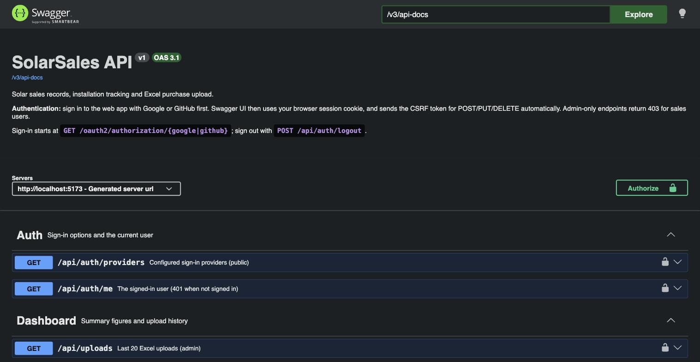

# ☀️ SolarSales: solar sales, installations & field agents

A full-stack web app for a solar business: **record sales, email customers their invoice and installation
progress, dispatch installation jobs to field agents, and bulk-import purchase records from Excel**.

**React 18 (Vite)** frontend · **Spring Boot 4 (Java 21+)** backend · server-side sessions with CSRF protection ·
sign-in with **email + password, mobile OTP or Google/GitHub** · role-based access (Admin / Sales / Agent) ·
interactive **Swagger UI**.


---

## Contents

- [Features](#features)
- [Roles & permissions](#roles--permissions)
- [Getting started](#getting-started)
- [Configuration](#configuration)
- [Setting up email, SMS and Google/GitHub](#setting-up-email-sms-and-googlegithub)
- [Customer email workflow](#customer-email-workflow)
- [Excel upload format](#excel-upload-format)
- [REST API & Swagger](#rest-api--swagger)
- [Project structure](#project-structure)
- [Architecture & design notes](#architecture--design-notes)
- [Testing](#testing)
- [Troubleshooting](#troubleshooting)

---

## Features

### Accounts & sign-in
- **One "Email or mobile number" field.** An email asks for a password; a mobile number gets a **6-digit SMS code**.
  New mobile numbers verify the code first, then fill in a short profile.
- **Google / GitHub** buttons appear when configured.
- **Sign-ups need approval.** New accounts choose *"Join as: Sales team / Installation agent"*, but that's only a
  request: they see a *Waiting for approval* screen until an admin approves them as **Sales** or **Agent** (or rejects).
  Admins get a 🔔 notification for every new sign-up.
- **Forgot password:** a single-use reset link by email (30 minutes). Asking for a link never locks the current
  password; setting the new one **signs out every session** of that account. The same applies to *Change password*
  and to an admin's *Set password*.
- **First run:** on an empty database the app asks to create the administrator. Everything about users and
  passwords lives in the database, with nothing in config files.
- Passwords are BCrypt-hashed; OTP codes and reset links are stored only as hashes.

### Sales (admins & sales users)
- **Dashboard:** revenue, collected vs outstanding, kW sold, pending installs, monthly revenue, panel mix.
- **Sales Records:** search, filters, sorting, paging, add sale; admins also edit, delete, export to Excel and
  see each sale's customer-email history (✉).
- **Installation Status:** Pending → Scheduled → In progress → Installed tracker; sales users and admins can update it
  (who changed it and when is recorded).

### Installation agents
- **My Tasks** (the agent's dashboard): only tasks they picked up or accepted, with *To do / Waiting for my acceptance /
  Completed* and **Update status**.
- **Available Tasks:** open jobs any agent can **Pick up** (first come, first served; a race has exactly one winner).
- **Notifications 🔔:** *New task assigned* → **clicking it accepts the task** and notifies the admins.
- Agents see customer name, phone, location and system details, **never prices, payments or sales records**.

### Admin
- **Assign Agents:** a dispatch board of new records without an agent (newest first, searchable), with per-row or
  **bulk assign**, reassign or remove, and each agent's current workload alongside.
- **Agents:** every agent's workload and a timeline of everything done by or for them (assigned, picked up,
  accepted, each status change).
- **Notifications 🔔:** acceptances, pickups, status updates, new sign-ups.
- **Upload Purchases:** Excel import with a validation preview; optionally email each customer their invoice.
- **Customer Emails:** every email sent to customers with status (Sent / Failed / Skipped + reason) and **Resend**.
- **Users:** approve sign-ups, change roles, enable or disable accounts, set passwords.
- **API docs:** Swagger UI at `/swagger-ui.html`.

| Sign in | Sales Records |
|---|---|
|  |  |

| Installation Status | Swagger UI |
|---|---|
|  |  |

---

## Roles & permissions

| | Waiting for approval | Sales user | Agent | Admin |
|---|:---:|:---:|:---:|:---:|
| Own profile, change password | ✅ | ✅ | ✅ | ✅ |
| Dashboard, sales records, add sales | | ✅ | | ✅ |
| Update installation status | | ✅ any sale | ✅ own accepted tasks | ✅ |
| My Tasks / Available Tasks / pick up / accept | | | ✅ | |
| Notifications 🔔 | | | ✅ | ✅ |
| Edit/delete sales, export, Excel upload, customer emails | | | | ✅ |
| Assign agents, Agents page, approve sign-ups, users | | | | ✅ |

Rules are enforced by the server (Spring Security + service checks). Role changes and disabled accounts take effect
on the user's very next request.

---

## Getting started

**Prerequisites:** Java 21+, Maven 3.9+, Node.js 18+.

```bash
git clone https://github.com/kushwahasushil1993/solar-sales.git
cd solar-sales

# backend (http://localhost:8081)
cd backend && mvn spring-boot:run

# frontend (http://localhost:5173), in a second terminal
cd frontend && npm install && npm run dev
```

1. Open **http://localhost:5173**. On a new database you're asked to **create the administrator account**.
2. The backend seeds **48 demo sales** (`DEMO-0001`…) on an empty database (`app.seed-demo-data=false` turns it off).
3. Team members sign up at **/register**; approve them on **Users** as Sales or Agent.
4. Give new records to agents on **Assign Agents**.

> Always use the app through **http://localhost:5173** in development. The Vite dev server proxies `/api`,
> `/oauth2`, `/login/oauth2` and the Swagger paths to the backend, so the browser sees one origin for the session
> cookie and for OAuth callbacks.

**Production:** `npm run build` (static files in `frontend/dist`) and `mvn clean package` (jar in `backend/target`).
Serve both on **one domain** and proxy `/api/`, `/oauth2/`, `/login/oauth2/`, `/swagger-ui`, `/v3/api-docs` to the
backend with the `Host` and `X-Forwarded-Proto` headers, plus `client_max_body_size 10m` for Excel uploads. Use HTTPS and
set `PUBLIC_URL` (used in password-reset links).

**PostgreSQL:** `DB_URL=jdbc:postgresql://localhost:5432/solar_sales DB_USERNAME=… DB_PASSWORD=… mvn spring-boot:run -Dspring-boot.run.profiles=postgres`

---

## Configuration

Defaults are in `backend/src/main/resources/application.properties`. **No secrets are committed:** put them in
`backend/local.properties` (git-ignored, imported automatically; see `backend/local.properties.example`) or in
environment variables. In `local.properties`, keep unused keys commented: an empty value overrides the environment
variable.

| Setting (property / env) | Default | Purpose |
|---|---|---|
| `app.mail.host` / `MAIL_HOST`, `MAIL_PORT`, `MAIL_USERNAME`, `MAIL_PASSWORD`, `MAIL_FROM` | *(none)* | SMTP for customer emails and password resets. Unset: emails are only logged and marked *Skipped* |
| `app.company.*` / `COMPANY_NAME`, `COMPANY_EMAIL`, `COMPANY_PHONE`, `COMPANY_ADDRESS`, `COMPANY_GSTIN`, `COMPANY_WEBSITE` | `SolarSales` | Seller details on invoices and emails |
| `app.sms.twilio.account-sid` / `TWILIO_ACCOUNT_SID`, `auth-token` / `TWILIO_AUTH_TOKEN`, `from` / `TWILIO_FROM` | *(none)* | SMS for mobile sign-in codes. Unset: codes are written to the backend log |
| `app.sms.twilio.verify-service-sid` / `TWILIO_VERIFY_SERVICE_SID` | *(none)* | Use **Twilio Verify** (works on Twilio trial accounts) |
| `app.sms.twilio.trial-template` / `TWILIO_TRIAL_TEMPLATE` | *(none)* | Trial only: send Twilio's predefined template (e.g. `sms_2fa`) |
| `app.sms.twilio.trial-allow-fixed-code` | `false` | ⚠️ Local testing only: accept the trial template's fixed sample code |
| `app.otp.message` | `Your verification code is {code}. It expires in {minutes} minutes. Do not share it.` | Own SMS text (paid Twilio) |
| `app.sms.default-country-code` / `SMS_DEFAULT_COUNTRY_CODE` | `91` | Added to numbers typed without a country code |
| `app.otp.ttl-seconds`, `resend-cooldown-seconds`, `max-per-hour`, `max-attempts`, `max-global-per-hour` | 300, 30, 5, 5, 200 | OTP limits |
| `app.password-reset.ttl-minutes` | `30` | Reset-link lifetime |
| `app.public-url` / `PUBLIC_URL` | request origin | Public address used in reset links (set in production) |
| `app.oauth.google.client-id/secret`, `app.oauth.github.client-id/secret` (`GOOGLE_CLIENT_ID` …) | *(none)* | Google/GitHub buttons |
| `app.seed-demo-data` | `true` | Demo sales on an empty database |
| `PORT` | `8081` | Backend port |

---

## Setting up email, SMS and Google/GitHub

**Gmail:** turn on 2-Step Verification, create an **App Password** at https://myaccount.google.com/apppasswords, then:
```properties
app.mail.host=smtp.gmail.com
app.mail.port=587
app.mail.username=you@gmail.com
app.mail.password=<16-letter app password>
app.mail.from=you@gmail.com
```
Personal Gmail sends roughly 500 emails a day; any other SMTP service uses the same settings.

**Twilio SMS:**
- **Paid account:** set `account-sid`, `auth-token` and `from`. The app sends `app.otp.message` with a fresh code.
- **Trial account:** custom SMS text is rejected (error 572006) and only verified recipients can be messaged. Use
  **Twilio Verify** (create a Verify service, set `TWILIO_VERIFY_SERVICE_SID`); Twilio creates and checks the codes.
  The `trial-template=sms_2fa` mode sends Twilio's predefined text, but that template always contains the same sample
  code, so the app refuses it unless `trial-allow-fixed-code=true`, which is **insecure and only for local testing**.
- Indian numbers: commercial SMS needs DLT registration; an India-focused provider (MSG91, Fast2SMS) may suit better.

**Google / GitHub:** create an OAuth client with callback `http://localhost:5173/login/oauth2/code/google` (or
`/github`) and set the client id and secret. GitHub uses `read:user user:email` to read a verified email; accounts
without a verified email are refused.

---

## Customer email workflow

Sent after the change is saved (never for a rolled-back change), on a background thread, recorded on
**Customer Emails**. The *Email the customer* tick box controls each change. Excel imports only email invoices when
you tick the box.

| Trigger | Email | Invoice included |
|---|---|:---:|
| Sale added | **Invoice** (order confirmation) | ✅ |
| Amount paid goes up | **Payment received** | ✅ |
| Total changed or paid corrected down | **Updated invoice** | ✅ |
| Installation → Scheduled / In progress / Installed | Status update (Installed = *completed*) | |

Every email shows **only the completed progress steps** (✓ Order placed, ✓ Installation scheduled, …).
Amounts use Indian grouping (₹3,25,000).

---

## Excel upload format

Download the template on **Upload Purchases**. Required columns: **Invoice No, Purchase Date, Customer Name,
Capacity (kW), Total Amount**. Optional: Phone, Email, City, State, Panel Type, Panel Count, Inverter Brand,
Amount Paid, Installation Status (`Pending / Scheduled / In progress / Installed`), Installation Date, Salesperson.
Headers are matched loosely (any order, common aliases), dates may be Excel dates or `YYYY-MM-DD` / `DD-MM-YYYY`,
amounts may contain `₹` and commas. Invalid rows are reported by Excel row number; valid rows are imported.

---

## REST API & Swagger

Full, always-current reference: **Swagger UI** at http://localhost:5173/swagger-ui.html (sign in to the web app
first; Swagger uses the session and sends the CSRF token for you).

| Area | Endpoints |
|---|---|
| Sign-in | `POST /api/auth/register`, `POST /api/auth/login` (form), `POST /api/auth/otp/request` · `/otp/verify` · `/otp/register`, `GET /oauth2/authorization/{google\|github}`, `POST /api/auth/logout`, `GET /api/auth/me` |
| Passwords & setup | `POST /api/auth/password/forgot`, `GET/POST /api/auth/password/reset`, `PUT /api/account/password`, `GET /api/setup`, `POST /api/setup/admin` |
| Sales | `GET/POST /api/sales`, `GET/PUT/DELETE /api/sales/{id}`, `PATCH /api/sales/{id}/installation`, `POST /api/sales/upload`, `GET /api/sales/template`, `GET /api/sales/export`, `GET /api/dashboard` |
| Customer emails | `GET /api/sales/{id}/notifications`, `POST /api/sales/{id}/notifications/invoice`, `GET /api/notifications`, `POST /api/notifications/{id}/resend` |
| Agents (agent) | `GET /api/tasks/available`, `GET /api/tasks/mine`, `POST /api/tasks/{id}/pick` · `/accept`, `PATCH /api/tasks/{id}/status` |
| Agents (admin) | `GET /api/tasks/board`, `POST /api/tasks/assign` (bulk), `POST /api/tasks/{id}/assign` · `/unassign`, `GET /api/agents`, `GET /api/agents/{id}/activity`, `GET /api/activity` |
| Notifications 🔔 | `GET /api/inbox`, `POST /api/inbox/{id}/open` (accepts an assigned task), `POST /api/inbox/read-all` |
| Users (admin) | `GET /api/users`, `PUT /api/users/{id}/role` · `/enabled` · `/password` |

All POST/PUT/PATCH/DELETE requests need the `X-XSRF-TOKEN` header (the value of the `XSRF-TOKEN` cookie). Errors use
RFC 9457 problem details (`{ status, title, detail, errors? }`).

---

## Project structure

```
solar-sales/
├── backend/                        Spring Boot API
│   ├── local.properties.example    template for git-ignored secrets
│   └── src/main/java/com/solar/sales/
│       ├── config/                 OpenAPI, demo data, LegacySchemaCleanup (DB upgrades)
│       ├── controller/             sales, dashboard, users, auth, setup, account, password reset
│       ├── entity/ dto/ repository/ exception/
│       ├── notification/           customer emails: templates, SMTP/log senders, workflow events
│       ├── otp/                    mobile sign-in: phone numbers, OTP service, Twilio channels
│       ├── passwordreset/          forgot-password links
│       ├── security/               session security, OAuth, password/OTP sign-in, ActiveUserFilter
│       ├── service/                sales, Excel import/export, dashboard, users
│       └── task/                   agent tasks, activity log, in-app notifications
├── frontend/src/
│   ├── api.js · auth.jsx · format.js
│   ├── components/                 layout, modals (sale, installation, assign agent, password), cards
│   └── pages/                      dashboard, sales, installations, my/available tasks, assign agents,
│                                   agents, notifications, customer emails, upload, users, sign-in pages
├── samples/sample-purchases.xlsx   example upload with valid + invalid rows
└── docs/screenshots/
```

---

## Architecture & design notes

- **One origin, server session.** The React app and API share an origin (Vite proxy / Nginx). Sign-in (password,
  OTP or OAuth) stores the same principal in an HttpOnly session cookie; `csrf.spa()` issues a readable
  `XSRF-TOKEN` that `api.js` echoes on writes.
- **ActiveUserFilter** re-reads the account on every request: role changes apply at once, and disabled accounts and
  sessions older than the last password change are signed out.
- **Emails after commit:** sale changes publish events handled after the transaction commits, sent on virtual
  threads, written in their own transaction, recorded with status and reason.
- **Agents:** picking a task is one atomic `UPDATE … WHERE task_state = 'OPEN'`; every assignment, pickup, acceptance
  and status change is written to an activity log and announced in the 🔔 inbox.
- **Database upgrades:** `ddl-auto=update` adds tables and columns; `LegacySchemaCleanup` (idempotent, H2 and
  PostgreSQL) relaxes old NOT NULL columns and turns enum columns into plain text, so new statuses and roles never
  break existing databases.

---

## Testing

```bash
cd backend && mvn test        # 130 tests
cd frontend && npm run build  # production build check
```

| Area | Tests |
|---|---|
| Security & accounts | SecurityTest (10), PasswordAuthTest (7), AccountAndSetupTest (8), PasswordResetTest (7), ApprovalTest (4), CsrfCookieTest (2), OAuthSignInTest (7) |
| Mobile sign-in | OtpAuthTest (13), PhoneNumbersTest (18), LocalCodeChannelTest (3), TwilioVerifyChannelTest (4), TwilioTrialTemplateChannelTest (4) |
| Customer emails | NotificationWorkflowTest (11), EmailTemplatesTest (8) |
| Sales & agents | SaleImportTest (7), InstallationUpdateTest (5), TaskWorkflowTest (9) |
| Upgrades | LegacySchemaCleanupTest (3): old databases accept new statuses, roles and email types |

Tests never contact Google, GitHub, Twilio or an SMTP server (fake senders and `MockRestServiceServer`).

---

## Troubleshooting

| Problem | Fix |
|---|---|
| "Invalid email or password" for an existing account | The account may have no password (mobile/Google sign-up). Use *Forgot password?*, or an admin uses *Set password* |
| Signed in but stuck on *Waiting for approval* | An admin must approve the account on **Users** |
| No SMS arrives | No SMS provider set (code is in the backend log), a trial Twilio account (see above), or the number has fewer than 10 digits |
| Customer emails show *Skipped* | SMTP not configured, or the customer has no email |
| OAuth `redirect_uri_mismatch` / callback goes to port 8081 | Register `http://localhost:5173/login/oauth2/code/…` and open the app on port 5173 |
| "Your session token is missing or expired" | Refresh the page (new CSRF token) |
| Port 8081 in use | `PORT=9090 mvn spring-boot:run` and update the proxy target in `frontend/vite.config.js` |
