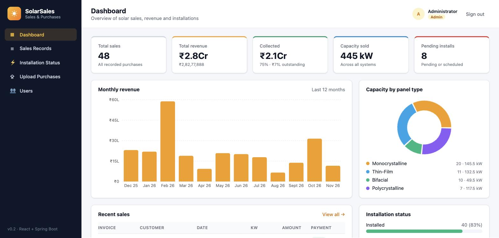
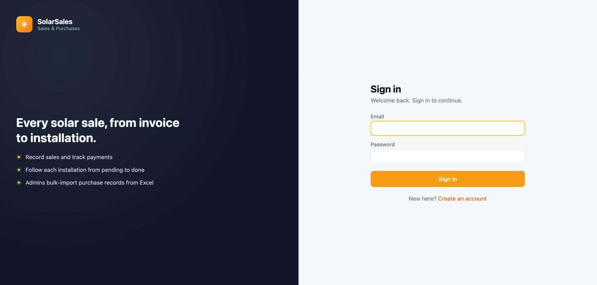
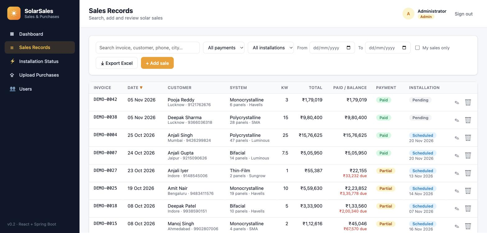
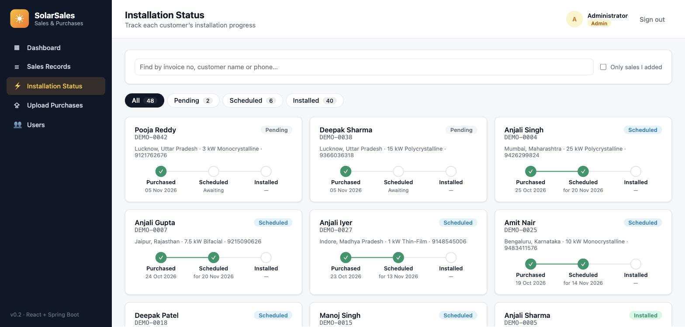
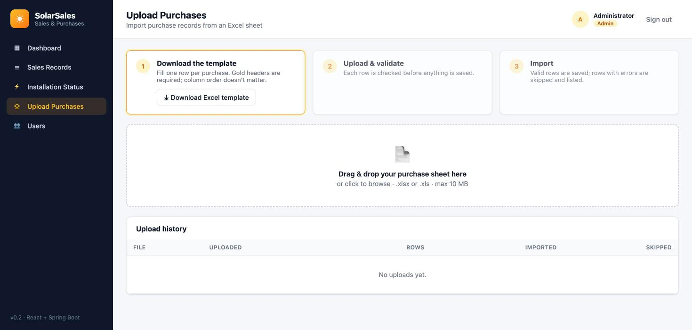

# ☀️ SolarSales: Solar Sales & Purchase Records

A full-stack web application for a solar panel business to **record sales, track payments, follow each
installation from purchase to completion, and bulk-import purchase records from Excel**.

Built with **React 18 (Vite)** on the frontend and **Spring Boot 4 (Java 21+)** on the backend, secured with
**JWT authentication** and **role-based access** (Admin / Sales user).



---

## Table of contents

- [Features](#features)
- [Screenshots](#screenshots)
- [Tech stack](#tech-stack)
- [Roles & permissions](#roles--permissions)
- [Getting started](#getting-started)
- [Configuration](#configuration)
- [Excel upload format](#excel-upload-format)
- [REST API](#rest-api)
- [Project structure](#project-structure)
- [Architecture & design notes](#architecture--design-notes)
- [Testing](#testing)
- [Troubleshooting](#troubleshooting)
- [Roadmap ideas](#roadmap-ideas)

---

## Features

### Authentication
- **Register** with name, email and password (min. 8 characters with a letter and a number) and you're signed in straight away.
- **Login** with email + password; the backend issues a signed **JWT** valid for 8 hours.
- Sessions survive a page reload; an expired or revoked session sends the user back to the login page.
- Passwords are stored as **BCrypt** hashes.

### Dashboard
- KPI cards: total sales, total revenue, amount collected vs. outstanding, total kW sold, pending installations.
- **Monthly revenue** bar chart for the last 12 months (empty months shown as zero).
- **Capacity by panel type** donut chart.
- **Installation status** progress bars and the 5 most recent sales.

### Sales Records
- Paginated table with **search** (invoice, customer, phone, email, city, salesperson).
- Filters: payment status, installation status, purchase date range, **"My sales only"**.
- Sortable columns (date, invoice, customer, kW, total, paid).
- **Add sale** form with field-level validation (all users).
- **Edit / delete** and **Export to Excel** with the current filters (admin only).
- Payment status (**Paid / Partial / Pending**) and **balance due** are calculated automatically from
  *Total Amount* and *Amount Paid*, so they can never disagree.

### Installation Status
- Card view of every sale with a **Purchased → Scheduled → Installed** progress tracker.
- Search by invoice number, customer name or phone; tabs by status with live counts.
- "Only sales I added" filter so sales staff can follow their own customers.

### Upload Purchases (admin only)
1. **Download the Excel template** (styled header, example row, instructions sheet).
2. **Drag & drop** an `.xlsx` / `.xls` file (max 10 MB).
3. Every row is **validated first (dry run)** and errors are listed by Excel row number.
4. **Import** the valid rows; invalid rows are skipped and reported.
- Upload history shows file name, time, rows, imported and skipped counts.

### User management (admin only)
- List all accounts with join date and last sign-in.
- **Promote to Admin / demote to Sales user** and **enable / disable** accounts.
- Safety rules: you can't demote or disable yourself, and the last active admin can't be removed.
- Role and status changes apply **immediately**, even to users who are already signed in.

---

## Screenshots

| Login | Sales Records |
|---|---|
|  |  |

| Installation Status | Upload Purchases (admin) |
|---|---|
|  |  |

---

## Tech stack

| Layer | Technology |
|---|---|
| Frontend | React 18, Vite 5, React Router 6, Recharts, plain CSS (no UI framework) |
| Backend | Spring Boot 4.1 (Spring MVC, Spring Data JPA, Bean Validation), Java 21+ |
| Security | Spring Security 7, OAuth2 Resource Server (JWT, HS256), BCrypt |
| Excel | Apache POI 5 (`.xlsx` and `.xls`) |
| Database | H2 (file-based, default for local dev) or PostgreSQL (`postgres` profile) |
| Tests | JUnit 5, Spring Boot Test, MockMvc, AssertJ |

---

## Roles & permissions

| Capability | Sales user (anyone who registers) | Admin |
|---|:---:|:---:|
| Sign in, view dashboard | ✅ | ✅ |
| View sales records | ✅ | ✅ |
| Add a sale (form) | ✅ (installation always starts as *Pending*) | ✅ |
| Track installation status | ✅ | ✅ |
| Set installation status / date | ❌ | ✅ |
| Edit or delete sales | ❌ | ✅ |
| Export sales to Excel | ❌ | ✅ |
| Upload purchase records (Excel), download template, upload history | ❌ | ✅ |
| Manage users (roles, enable/disable) | ❌ | ✅ |

Permissions are enforced **on the server** (Spring Security URL rules plus service checks). The UI hides
admin-only controls, but hiding them is not what protects the data.

### The first admin
On startup the backend creates an admin account (`ADMIN_EMAIL`, default `admin@solarsales.local`) if no user
with that email exists:
- with the password from `ADMIN_PASSWORD`, if set, or
- with a **random password printed once in the startup log** (look for `Created admin account`).

Further admins are promoted from the **Users** page.

> 🔐 **No secrets are committed to this repository.** The JWT key and admin password come from environment
> variables or a git-ignored `backend/local.properties` (see [Configuration](#configuration)).

---

## Getting started

### Prerequisites
- **Java 21+** (developed with JDK 26)
- **Maven 3.9+**
- **Node.js 18+** and npm

### 1. Clone
```bash
git clone https://github.com/kushwahasushil1993/solar-sales.git
cd solar-sales
```

### 2. Start the backend (port 8081)
```bash
cd backend
mvn spring-boot:run
```
Optionally copy the config template first, so sign-ins survive restarts and you choose the admin password:
```bash
cp local.properties.example local.properties   # then fill in app.jwt.secret and app.admin.password
```

On first start it:
- creates the database in `backend/data/` (H2 file DB),
- creates the admin account and, if you didn't set a password, **prints a generated one in the log**,
- seeds **48 demo sales** (`DEMO-0001` …) so the dashboard has data. Turn this off with `app.seed-demo-data=false`.

### 3. Start the frontend (port 5173)
```bash
cd frontend
npm install
npm run dev
```
Open **http://localhost:5173**. The Vite dev server proxies `/api` to `http://localhost:8081`.

### 4. Try it
1. Sign in with the admin account, or register a new (sales user) account.
2. As admin, go to **Upload Purchases** and drop `samples/sample-purchases.xlsx`.
   It has 5 valid rows and 3 rows with deliberate errors, so you can see the validation report.
3. Open **Installation Status** to follow the imported sales.

### Production build
```bash
cd frontend && npm run build        # static files in frontend/dist
cd backend  && mvn clean package    # runnable jar in backend/target
java -jar backend/target/solar-sales-0.0.1-SNAPSHOT.jar
```
Serve `frontend/dist` from any static host / reverse proxy and route `/api` to the backend.

### Using PostgreSQL
```bash
createdb solar_sales
cd backend
DB_URL=jdbc:postgresql://localhost:5432/solar_sales DB_USERNAME=postgres DB_PASSWORD='<your-db-password>' \
  mvn spring-boot:run -Dspring-boot.run.profiles=postgres
```
Tables are created automatically (`ddl-auto=update`). Demo data is disabled in this profile.

---

## Configuration

Settings live in `backend/src/main/resources/application.properties`. **Secrets have no committed values**:
set them as environment variables or in `backend/local.properties` (git-ignored, imported automatically;
template: `backend/local.properties.example`).

| Property | Env variable | Default | Purpose |
|---|---|---|---|
| `server.port` | `PORT` | `8081` | Backend HTTP port |
| `app.jwt.secret` | `JWT_SECRET` | *(none)*: random key per start | Base64 key (≥ 32 bytes) that signs JWTs. Generate: `openssl rand -base64 48`. If unset, everyone is signed out on restart |
| `app.jwt.expiry-hours` | — | `8` | Token lifetime |
| `app.admin.email` | `ADMIN_EMAIL` | `admin@solarsales.local` | Admin created on startup |
| `app.admin.password` | `ADMIN_PASSWORD` | *(none)*: generated and logged once | Password for that admin (only used when the account is first created) |
| `app.admin.name` | `ADMIN_NAME` | `Administrator` | Display name for that admin |
| `app.seed-demo-data` | — | `true` | Insert demo sales when the table is empty |
| `app.cors.allowed-origins` | — | `http://localhost:5173` | Allowed browser origins |
| `spring.servlet.multipart.max-file-size` | — | `10MB` | Max Excel upload size |
| `spring.datasource.*` | `DB_URL`, `DB_USERNAME`, `DB_PASSWORD` (postgres profile) | H2 file DB | Database connection |

Example:
```bash
JWT_SECRET=$(openssl rand -base64 48) ADMIN_EMAIL=you@example.com ADMIN_PASSWORD='<choose-a-strong-password>' \
  mvn spring-boot:run
```

To reset local data, stop the backend and delete `backend/data/`. This also deletes user accounts.

---

## Excel upload format

Download the template from **Upload Purchases → Download Excel template** (or `GET /api/sales/template`).
Required headers are highlighted in gold.

| Column | Required | Accepted values / notes |
|---|:---:|---|
| Invoice No | ✅ | Unique. Duplicates (in the DB or repeated within the file) are rejected |
| Purchase Date | ✅ | Excel date, or text `YYYY-MM-DD`, `DD-MM-YYYY`, `DD/MM/YYYY`, `DD.MM.YYYY`, `12-Oct-2026`. Not in the future |
| Customer Name | ✅ | |
| Capacity (kW) | ✅ | ≥ 0.1 |
| Total Amount | ✅ | > 0. `₹`, `Rs`, `INR` and commas are allowed, e.g. `₹3,25,000` |
| Phone | | Numbers or text (`9876543210` stays intact) |
| Email | | Must be a valid email if present |
| City, State | | |
| Panel Type | | e.g. Monocrystalline, Polycrystalline, Bifacial, Thin-Film |
| Panel Count | | Whole number |
| Inverter Brand | | |
| Amount Paid | | 0 … Total Amount (blank = 0) |
| Installation Status | | `Pending`, `Scheduled` or `Installed` (case-insensitive, blank = Pending) |
| Installation Date | | Not before Purchase Date |
| Salesperson | | |

**Flexible parsing**
- The header row is detected automatically within the first 10 rows; column **order doesn't matter**.
- Headers are matched ignoring case, spaces and punctuation, and common **aliases** work, e.g.
  `Invoice Number`, `Bill No`, `Customer`, `Mobile`, `System Size`, `kW`, `Amount`, `Price`, `Paid`, `Advance`.
- Unknown columns and blank rows are ignored; formula cells use their calculated value.
- A file exported from **Sales Records → Export Excel** can be re-imported as is.

**Validation report example**
```
Row 6  INV-2005  Amount paid cannot exceed total amount; Customer name is required
Row 7  INV-2002  Duplicate invoice in file (first seen on row 3)
Row 8  INV-2006  Capacity (kW): 'five' is not a valid number; Installation Status: Invalid installation status 'Done'
```

---

## REST API

Base URL: `http://localhost:8081/api`. All endpoints except **register** and **login** require
`Authorization: Bearer <token>`. 🔒 = admin only. Errors use the RFC 9457 *problem details* format
(`{ status, title, detail, errors? }`).

### Auth
| Method | Path | Body | Returns |
|---|---|---|---|
| POST | `/auth/register` | `{ fullName, email, password }` | `201 { token, expiresAt, user }` (role USER) |
| POST | `/auth/login` | `{ email, password }` | `{ token, expiresAt, user }` |
| GET | `/auth/me` | — | current user |

### Sales
| Method | Path | Notes |
|---|---|---|
| GET | `/sales` | Query: `search, paymentStatus, installationStatus, panelType, from, to, mine, page, size, sortBy, direction` → `{ content, page, size, totalElements, totalPages }` |
| GET | `/sales/{id}` | |
| POST | `/sales` | Create. Non-admins: installation status forced to PENDING |
| PUT | `/sales/{id}` | 🔒 Update |
| DELETE | `/sales/{id}` | 🔒 Delete |
| POST | `/sales/upload?dryRun=true\|false` | 🔒 multipart field `file`. Returns `{ batchId, fileName, totalRows, importedRows, failedRows, errors[] }` |
| GET | `/sales/template` | 🔒 Excel template download |
| GET | `/sales/export` | 🔒 Excel export (same filters as list) |

### Dashboard, uploads, users
| Method | Path | Notes |
|---|---|---|
| GET | `/dashboard` | KPIs, monthly series, breakdowns, recent sales |
| GET | `/uploads` | 🔒 Last 20 Excel uploads |
| GET | `/users` | 🔒 All users |
| PUT | `/users/{id}/role` | 🔒 `{ "role": "ADMIN" \| "USER" }` |
| PUT | `/users/{id}/enabled` | 🔒 `{ "enabled": true \| false }` |

### Quick curl example
```bash
TOKEN=$(curl -s -X POST localhost:8081/api/auth/login -H 'Content-Type: application/json' \
  -d '{"email":"admin@solarsales.local","password":"<admin password>"}' | jq -r .token)

curl -H "Authorization: Bearer $TOKEN" "localhost:8081/api/sales?search=pune&size=5"
curl -H "Authorization: Bearer $TOKEN" -F file=@samples/sample-purchases.xlsx \
  "localhost:8081/api/sales/upload?dryRun=true"
```

### Status codes
| Code | Meaning |
|---|---|
| 400 | Validation failed (`errors` holds field → message), or an unreadable / invalid Excel file |
| 401 | Not signed in, token expired/invalid, account disabled, or wrong email/password |
| 403 | Signed in but not allowed (admin-only action, or a protected admin operation) |
| 404 | Sale or user not found |
| 409 | Invoice number or email already exists |
| 413 | Upload larger than 10 MB |

---

## Project structure

```
solar-sales/
├── backend/                         Spring Boot API
│   ├── pom.xml
│   ├── local.properties.example     template for git-ignored local secrets
│   └── src/
│       ├── main/java/com/solar/sales/
│       │   ├── config/              AdminBootstrap, DemoDataSeeder, WebConfig (CORS)
│       │   ├── controller/          Auth, Sale, Dashboard, User REST controllers
│       │   ├── dto/                 Request/response records
│       │   ├── entity/              SolarSale, AppUser, UploadBatch, enums
│       │   ├── exception/           Custom exceptions + GlobalExceptionHandler
│       │   ├── repository/          Spring Data JPA repositories
│       │   ├── security/            SecurityConfig, JwtService, AuthUser
│       │   └── service/             SaleService, ExcelService, ExcelColumn,
│       │                            DashboardService, UserService
│       ├── main/resources/          application.properties, application-postgres.properties
│       └── test/                    SaleImportTest, SecurityTest
├── frontend/                        React app (Vite)
│   ├── vite.config.js               dev server + /api proxy
│   └── src/
│       ├── api.js                   fetch wrapper, JWT header, downloads
│       ├── auth.jsx                 AuthProvider, RequireAuth, RequireAdmin
│       ├── format.js                ₹ / date formatting, enums
│       ├── components/              Layout, AuthLayout, Modal, SaleFormModal, Badge, ...
│       └── pages/                   Login, Register, Dashboard, SalesRecords,
│                                    Installations, UploadPurchases, Users
├── samples/sample-purchases.xlsx    example upload with valid + invalid rows
└── docs/screenshots/                images used in this README
```

---

## Architecture & design notes

```
Browser (React SPA) ──/api──▶ Vite proxy (dev) ──▶ Spring Boot :8081
                                                     ├─ Security filter chain (JWT → AuthUser + ROLE_*)
                                                     ├─ Controllers → Services → JPA repositories → H2/PostgreSQL
                                                     └─ ExcelService (Apache POI) for template / import / export
```

- **Stateless JWT auth.** The token only carries the user id. On every request the user is re-loaded, so a
  role change or a disabled account takes effect immediately rather than when the token expires.
- **Two-step import.** The UI first calls upload with `dryRun=true` to show the validation report, then imports.
  Valid rows are saved in one transaction; invalid rows never block valid ones.
- **Validation in one place.** Excel rows are parsed into the same `SaleRequest` record used by the form, so
  the API and the importer apply identical Bean Validation rules. Cell-level parse errors suppress duplicate
  "is required" messages for the same field.
- **Derived payment status.** `paymentStatus` is computed in the entity (`@PrePersist/@PreUpdate`) from amounts.
- **Audit trail.** Every sale records who created it (`createdByName`) and its source (`MANUAL`, `EXCEL`, `DEMO`).
- **Currency & locale.** Amounts are shown in Indian Rupees with Indian digit grouping (₹2,82,77,888 / ₹2.8Cr).
  Change `format.js` to use another currency.

---

## Testing

```bash
cd backend
mvn test
```

14 tests:

- **SaleImportTest** (7): header aliases and column order, `₹`/comma amounts, text and serial dates, numeric
  phone numbers, duplicate invoices (in DB and in file), dry run, missing required columns, non-Excel files,
  template round trip, export → re-import round trip.
- **SecurityTest** (7): unauthenticated access, registration (role, duplicate email, password rules), wrong
  password, user vs. admin permissions on every protected endpoint, immediate effect of role changes and
  disabling, admin self-protection.

Frontend production build check:
```bash
cd frontend && npm run build
```

---

## Troubleshooting

| Problem | Fix |
|---|---|
| `Port 8081 was already in use` | Start with another port: `PORT=9090 mvn spring-boot:run`, and update the proxy target in `frontend/vite.config.js` |
| UI shows "Cannot reach the server" | The backend isn't running, or it runs on a different port than the Vite proxy expects |
| Lost the generated admin password | Promote another account from the Users page, or stop the backend, delete `backend/data/` (wipes all data) and restart with `ADMIN_PASSWORD` set |
| Signed out after every restart | Set `JWT_SECRET` or `app.jwt.secret` in `backend/local.properties` |
| "Could not find a header row" | Keep the header row in the first 10 rows and include at least two recognised column names |
| Dates imported wrongly | Use real Excel date cells or `YYYY-MM-DD`; ambiguous `MM/DD` text is read as `DD/MM` |
| Got signed out unexpectedly | The token expired (8 h) or an admin disabled the account |

---

## Roadmap ideas

- Password reset by email, and refresh tokens
- Per-sale activity log (who changed installation status and when)
- PDF invoice generation
- Docker Compose (backend + PostgreSQL + Nginx serving the frontend)
- Restricting sales users to only their own customers, if required
